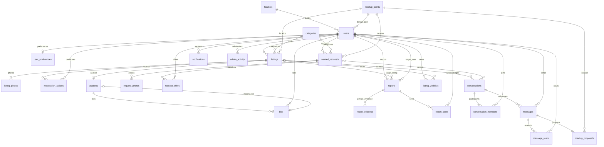

# Database decisions

Decisions made for the `fullstack` implementation, 15 November 2026. Basis: actual `Gm-Frontend` and `Gm_Backend` sources plus the three handoff briefs; no competition guidebook was present.

| Area | Implemented decision and reason |
| --- | --- |
| Existing backend | Preserve `isAdmin()` concept; consolidate role into one migration with `student/admin` matching the frontend. No duplicate users table. |
| Identity | Existing Laravel users/password reset/session tables and hashing; server sessions, CSRF, login throttling, lowercase email. Role/status are never copied from public registration input. |
| Database engines | SQLite for local/test convenience; MySQL 8.4 verified. FKs, indexes, composite uniqueness and range/state checks. SQLite equivalent triggers enforce new range checks because SQLite cannot add CHECKs to existing tables. |
| Lookups | 7 categories, 20 faculty codes, 26 meet-up points from the frontend. Category and meet-up references use real FKs. Inactivate reference rows instead of deleting in-use rows. |
| Money and dates | Whole rupiah integers, maximum Rp1,000,000,000,000. Stored timestamps UTC; meet-up input interpreted as Asia/Jakarta. Map coordinates remain schematic percentages. |
| Listings | Single listing row with moderation and separate availability. Soft deletion. Visibility includes approved status and active seller. Owner content edits return to pending; admin edits are audited. |
| Review history | Immutable moderation-action rows record admin decisions; admin_activity records privileged actions. Rejection requires a reason. Suspension changes user state, not listing moderation. |
| Auctions | Approval starts the clock once. All financial/content edits blocked after auction approval. Bids/buy-now/finalization use transactions and locks with retries. Winner chosen from that auction by the service. Winner FK uses a two-stage migration to resolve the cycle. |
| Wanted requests | Requests go live without an approval gate. A requester cannot offer on their own request; unique request/user offers; withdrawals allow resubmission. Found/expired requests reject offers. Admins may remove requests. |
| Reports | Unified `reports` table with kind scam/bug/listing/user/other and optional listing/user FKs. `review/verified/dismissed` states; dismissed means resolved/closed for non-scam kinds. Only scam reports can be verified publicly. Public title/summary are separate from private narrative/identifier/evidence. |
| Chat | Conversations have a unique ordered participant-pair/context key; listing/request refs are explicit nullable FKs and mutually exclusive. Exactly two members enforced transactionally. Only members may read/send, and only the recipient may answer a meet-up. |
| Files | Validated JPEG/PNG/WebP, up to 5 MB each; decoded and re-encoded as JPEG. Listing photos 1–4, request photos 0–3, report evidence 0–3. Store paths rather than base64. Failed multi-file writes are cleaned up. Report and chat images use private storage with authorized downloads. |
| Privacy | Public users omit email, hidden phone/faculty and preferences. Private request-offer text is visible only to owner/admin/offerer. Public scam projections omit evidence/identifiers/anonymous reporter. Read counts do not expose other readers' IDs. |
| Saved items | Unique user/listing rows; requests are not wishlist items. Request save controls removed to match this scope. The last published listing price is separate from the price when an item was saved; approved price reductions generate one notification, including seller edits that require reapproval. |
| Retention | Listings/requests soft-delete; users and audit/chat references restrict deletion. Self-service account deletion disabled pending a retention/anonymization policy. |
| Browser integration | Server bootstrap plus asynchronous mutations and authorized snapshots. UI callbacks await writes. Periodic refresh skips active forms/dialogs and unchanged snapshots. No default accounts or client password hashes. |

## Relationship map

Actual executable column definitions, FK deletion behavior, enums, unique keys and indexes live in the migrations. Counts/ownership rules spanning several rows (photo minimums, exactly two chat members, winner belonging to the auction) are enforced by services and covered by feature tests, rather than represented as ordinary row CHECK constraints.
