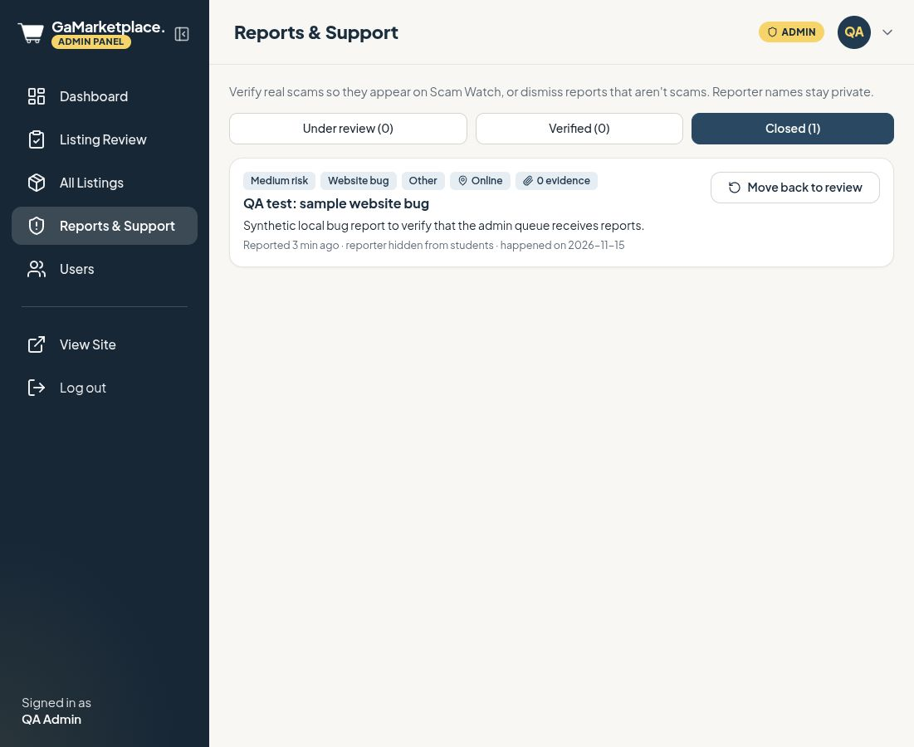

# Verification record

Verified locally on 15 November 2026 on the uncommitted `fullstack` branch, based on `Gm-Frontend`. No public deployment, commit or push was performed.

## Automated results

| Check | Result |
| --- | --- |
| Complete Laravel suite, SQLite | **58 passed, 3 skipped**, 305 assertions (61 tests total) |
| Marketplace feature suite, MySQL 8.4.10 | **31 passed**, 231 assertions |
| PHPStan / Larastan, repository configuration | **Passed**, zero errors, 512 MB memory limit |
| Laravel Pint, complete repository | **Passed** |
| TypeScript / Vue type checking | **Passed** |
| Frontend production build | **Passed**; font downloads required network access |
| JavaScript syntax, all 22 served marketplace scripts | **Passed** |
| Laravel route cache | **Passed**; API routes have unique names; cache cleared afterward for development |
| Git whitespace check | **Passed** |
| `npm run check` | **Not clean**: formatter reported 103 files, including preserved `frontend-original` assets and edited marketplace scripts. This is a formatting issue; do not describe the aggregate CI command as passing. |

The three skipped tests belong to the starter's optional two-factor security page. Two-factor authentication is not enabled in the current Fortify configuration. No marketplace tests were skipped.

SQLite tests use an in-memory database. MySQL tests ran against a separate disposable database through a local socket, with networking disabled. Migrations and lookup seeding were also exercised on MySQL. These tests did not reset the working SQLite database or any external database.

The feature suite covers registration input and role protection, session login/logout, suspension, admin authorization, profile ownership/privacy, password changes, CSRF, login throttling, listing approval/rejection/editing, category/meet-up references, malformed requests, product requests/offers, admin request access, report redaction and evidence authorization, range/uniqueness constraints, auction increments/buy-now/expiry, context-specific chat, private images, meet-up responses, wishlists, notification ownership and preferences, and price-drop alerts after approval without duplicate alerts.

## Browser observations

Using the served Blade/JavaScript application and synthetic local accounts:

- A student signed in, submitted a product request and reloaded the page; the saved request remained present.
- The student submitted a website bug report.
- An administrator signed in, found that report in Reports & Support and closed it with a resolution note.
- The browser console reported no errors during these observed flows.

The later Product Requests admin tab was checked by the backend page-access test and JavaScript syntax checks, not a second browser walkthrough. Other workflows have feature-test coverage but were not all manually exercised in the browser.

## Scope of confidence

This verifies a functional local competition prototype. It is not a production security certification, a concurrency stress test or a load test. Auction writes use transactional locking and idempotent finalization, but high-concurrency behavior has not been benchmarked. Full-state polling needs pagination and narrower endpoints before large-scale use.

SSO, verified email ownership, real email delivery, weekly email summaries, payments and production hosting are not configured. See [the setup guide](FULLSTACK_SETUP.md) for operating instructions and remaining configuration, and [the schema decisions](schema-decisions.md) for database versus service-level constraints.
